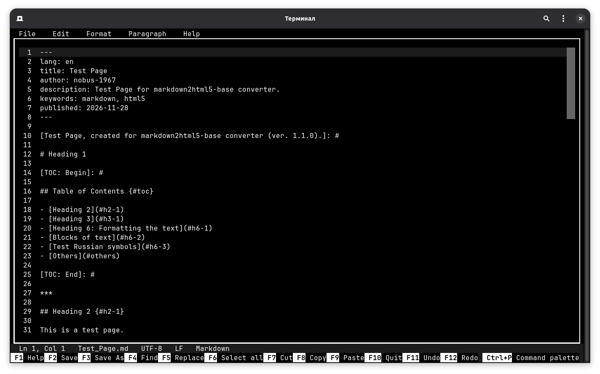

# Mark Editor TUI



A terminal Markdown editor written in Python with [Textual](https://textual.textualize.io/). It runs in a modern terminal on Linux.

Mark Editor TUI is based on [Mark Editor](https://github.com/nobus-1967/mark_editor). Markdown is converted to styled HTML5 by [markdown2html5-base](https://github.com/nobus-1967/markdown2html5-base), and PDF export is produced by printing that HTML5 with headless [Chromium](https://www.chromium.org/).

**Current version: 0.3.1 (2026.11).**

## Features

- Edit Markdown with syntax highlighting, line numbers, soft wrap and a cursor-line highlight.
- File actions: New, Open, Reopen, Save, Save As.
- Export: HTML5 (portrait), PDF (portrait or landscape) and plain text.
- Find, replace and replace-all, optionally with regular expressions.
- Formatting: bold, italic, underline, strikethrough, superscript, subscript, inline code, highlighted text, links, header IDs, header links, footnotes, comments and escapes.
- Paragraph commands: headings 1–6, paragraphs, ordered/unordered/todo lists, definition lists, blockquotes, fenced code blocks, images, horizontal rules, hard line breaks and YAML Front Matter.
- Tables: create tables with headers, body rows and an optional footer; add rows; set cell alignment; balance column widths.
- Table of contents: add, regenerate, remove, or add heading IDs only.
- Language markers, BCP 47 language-code picker, furigana/ruby annotations, emoji shortcodes, special signs and date/time insertion.
- Four color themes (`default`, `green`, `magenta`, `blue`) with `File → Toggle Theme` (`Alt+T`), persisted between runs.
- Command palette (`Ctrl+P`), clickable menu bar, clickable F1–F12 bar and modal dialogs.
- Built-in help: keyboard shortcuts and About with version `0.3.1 (2026.11)`.
- External file changes are detected and the open file is reloaded automatically.

Browser preview is intentionally not part of the TUI. Use HTML5 or PDF export when a rendered document is needed.

## Requirements

- GNU/Linux
- Python >= 3.10
- [Textual](https://pypi.org/project/textual/) >= 8.0
- [markdown2html5-base](https://github.com/nobus-1967/markdown2html5-base) >= 1.1.0
- [Chromium](https://www.chromium.org/) for PDF export

## Installation

From the application directory:

```bash
cd application
python3 -m venv ../venv
../venv/bin/python -m pip install -e .
```

This installs the `mark_editor_tui` command and the dependencies declared in `pyproject.toml`.

For development tools:

```bash
../venv/bin/python -m pip install -e ".[dev]"
```

## Running

After installation:

```bash
../venv/bin/mark_editor_tui [FILE]
```

From a source checkout without installing the package:

```bash
cd application
PYTHONPATH=src python3 -m mark_editor_tui.main [FILE]
```

The optional `FILE` argument opens a Markdown document at startup.

Command-line options:

| Option            | Description                        |
| :---              | :---                               |
| `-h`, `--help`    | Show help and exit.                |
| `-v`, `--version` | Show version information and exit. |

## Function-key layout

The F1–F12 row follows a classic console-editor layout and is the primary shortcut set. Ctrl and Alt combinations remain available as aliases. The row ends with a clickable `Ctrl+P Command palette` hint.

| Key   | Action     | Key   | Action |
| :---: | :---       | :---: | :---   |
| `F1`  | Help       | `F7`  | Cut    |
| `F2`  | Save       | `F8`  | Copy   |
| `F3`  | Save As    | `F9`  | Paste  |
| `F4`  | Find       | `F10` | Quit   |
| `F5`  | Replace    | `F11` | Undo   |
| `F6`  | Select All | `F12` | Redo   |

## Terminal-safe shortcuts

Some desktop shortcuts are reserved by terminals or shells. Mark Editor TUI uses function keys or Alt combinations for those actions:

| Action            | Primary shortcut    | Why it changed                                              |
| :---              | :---                | :---                                                        |
| Undo              | `F11`               | `Ctrl+Z` may send `SIGTSTP`.                                |
| Redo              | `F12`               | Keeps Undo/Redo on the function-key row.                    |
| Quit              | `F10`               | `Ctrl+Q` is flow control in many terminals.                 |
| Save              | `F2`                | Some terminals intercept `Ctrl+S`.                          |
| Copy              | `F8`                | `Ctrl+Shift+C` belongs to the terminal emulator.            |
| Paste             | `F9`                | Terminal paste is commonly `Ctrl+Shift+V` / `Shift+Insert`. |
| Select all        | `F6`                | `Ctrl+A` moves to line start in terminals.                  |
| Find              | `F4`                | `Ctrl+Shift+F` is terminal search.                          |
| Replace           | `F5`                | `Ctrl+Shift+H` may be terminal replace.                     |
| Cut               | `F7`                | Avoids terminal-reserved combinations.                      |
| Delete line       | `Alt+D`             | No free function key remains.                               |
| Language wrapping | `Alt+Shift+W`       | `Ctrl+Shift+W` closes a terminal tab.                       |
| Code block        | `Alt+Shift+K`       | `Ctrl+Shift+K` may clear scrollback.                        |
| Table alignment   | `Alt+Shift+T`       | `Ctrl+Shift+T` opens a terminal tab.                        |
| Balance table     | `Alt+Shift+N`       | `Ctrl+Shift+N` opens a terminal window.                     |
| Clear formatting  | `Alt+Shift+F`       | `Ctrl+Shift+F` is terminal search.                          |
| Italic            | `Alt+I`             | `Ctrl+I` is the same byte as Tab.                           |
| Comment           | `Alt+M`             | `Ctrl+M` is the same byte as Enter.                         |
| Line break        | `Alt+Enter`         | `Ctrl+\` can send `SIGQUIT`.                                |
| Headings 1–6      | `Alt+1` ... `Alt+6` | Compatible with terminal `ESC`+digit sequences.             |

Press `F1` or open **Help → Keyboard Shortcuts** for the complete list.

## Keyboard overview

### File

| Action         | Shortcut                              |
| :---           | :---                                  |
| New file       | `Ctrl+N`                              |
| Open           | `Ctrl+O`                              |
| Reopen         | `Ctrl+Shift+O`                        |
| Save / Save As | `F2`, `Ctrl+S` / `F3`, `Ctrl+Shift+S` |
| Export         | `Ctrl+E`                              |
| Toggle theme   | `Alt+T`                               |
| Quit           | `F10`                                 |

### Edit

| Action                 | Shortcut                                                                         |
| :---                   | :---                                                                             |
| Undo / Redo            | `F11`, `Ctrl+Z` / `F12`, `Ctrl+Y`                                                |
| Cut / Copy / Paste     | `F7`, `Ctrl+X`, `Shift+Delete` / `F8`, `Ctrl+C` / `F9`, `Ctrl+V`, `Shift+Insert` |
| Select all / Deselect  | `F6`, `Ctrl+A` / `Ctrl+Shift+A`                                                  |
| Find / Replace         | `F4`, `Ctrl+F` / `F5`, `Ctrl+R`                                                  |
| Go to line             | `Ctrl+_`                                                                         |
| Delete line            | `Alt+D`                                                                          |
| Indent / Outdent       | `Tab` / `Shift+Tab`                                                              |
| Move line or selection | `Alt+Up` / `Alt+Down`                                                            |

### Formatting

| Action                     | Shortcut                          |
| :---                       | :---                              |
| Bold                       | `Ctrl+B`                          |
| Italic                     | `Alt+I`                           |
| Underline                  | `Ctrl+U`                          |
| Strikethrough              | `Ctrl+D`                          |
| Superscript / Subscript    | `Ctrl+Shift+P` / `Ctrl+Shift+B`   |
| Inline code                | `Ctrl+K`                          |
| Mark / Highlight           | `Ctrl+Shift+M`                    |
| Hyperlink                  | `Ctrl+L`                          |
| Header ID / Header link    | `Alt+H` / `Ctrl+Shift+H`          |
| Table of contents          | `Ctrl+Shift+E`                    |
| Footnote                   | `Ctrl+Shift+U`                    |
| Date and time              | `Ctrl+Shift+D`                    |
| Language marker / wrapping | `Ctrl+W`, `Alt+W` / `Alt+Shift+W` |
| Language codes             | `Alt+L`                           |
| Furigana                   | `Ctrl+Shift+J`                    |
| Emoji / Special signs      | `Alt+E` / `Alt+S`                 |
| Special mark (backslash)   | `Ctrl+Shift+L`                    |
| Clear formatting           | `Alt+Shift+F`                     |

### Paragraphs and blocks

| Action                   | Shortcut                  |
| :---                     | :---                      |
| Heading 1–6              | `Alt+1` ... `Alt+6`       |
| Paragraph                | `Alt+0`                   |
| Ordered / Unordered list | `Ctrl+G` / `Ctrl+Shift+G` |
| Todo list                | `Alt+C`                   |
| Definition list          | `Ctrl+Shift+X`            |
| Code block               | `Alt+Shift+K`             |
| Blockquote               | `Alt+Q`                   |
| Table                    | `Ctrl+T`                  |
| Add table row            | `Ctrl+Shift+R`            |
| Table alignment          | `Alt+Shift+T`             |
| Balance table            | `Alt+Shift+N`             |
| Image                    | `Alt+G`                   |
| Horizontal rule          | `Alt+-`                   |
| Comment                  | `Alt+M`                   |
| YAML Front Matter        | `Ctrl+Shift+Y`            |
| Line break               | `Alt+Enter`               |

### Help and palette

| Action                        | Shortcut           |
| :---                          | :---               |
| Command palette               | `Ctrl+P`           |
| Help                          | `F1`               |
| Menus                         | Click a menu title |
| Close menu or command palette | `Esc`              |

## Themes

**File → Toggle Theme** or `Alt+T` cycles through four themes:

| Theme     | Appearance                                                |
| :---      | :---                                                      |
| `default` | Dark background, white text, white active elements.       |
| `green`   | Dark background with green text and highlights.           |
| `magenta` | Dark background with magenta text and highlights.         |
| `blue`    | Deep-blue background with pale-blue text and navy panels. |

The selected theme is stored in `~/.config/mark_editor_tui/theme.json` under the `mode` key. Delete that file to return to the default theme. A repository palette reference is in [themes.md](./themes.md).

The terminal emulator controls the font family and rendering size in the TUI. Exported HTML5 and PDF documents use the font stack embedded by `markdown2html5-base`; PDFs are rendered by Chromium, which resolves those fonts on the host system.

## Package structure

```text
application/
  pyproject.toml        # Build metadata, dependencies, entry point and tooling
  README.md
  themes.md             # Palette reference for the repository
  LICENSE
  requirements.txt      # Runtime dependencies (mirrors pyproject.toml)
  build.sh              # PyInstaller build script
  assets/
    docs/
      cheatsheet.md     # Keyboard shortcuts (same as Help → Keyboard Shortcuts)
    images/             # Screenshots and icons
  src/
    mark_editor_tui/
      __init__.py       # Package metadata
      __main__.py       # python -m mark_editor_tui
      main.py           # CLI entry point
      app.py            # Textual application, actions and menus
      editor.py         # Markdown TextArea widget
      screens.py        # Modal dialogs and file choosers
      menubar.py        # Menu bar and F1–F12 bar
      markdown_ops.py   # Pure Markdown text transformations
      helpers.py        # Conversion, TOC, temp-file and PDF helpers
      themes.py         # Application and editor color themes
      constants.py      # Version, theme names, formats and language tables
      help_text.py      # Help and About documents
      compat.py         # Terminal key compatibility helpers
      styles.tcss       # Textual stylesheet
  tests/
    test_editor.py      # Unit and headless UI tests
```

## Temporary files

While editing, the buffer is saved to a temporary Markdown file so unsaved work can be restored:

- No file open: `~/.cache/mark_editor_tui/Temp.md`
- File open: `<directory>/~<filename>.md` next to the document

Temporary Markdown files are deleted when a document is closed, when opening or reopening another file, and when the editor exits via Quit or a termination signal. The cached unsaved-buffer file is removed on exit as well.

PDF export writes a temporary HTML5 file named after the source document (`<stem>.html` next to the source file, or `document.html` for an unsaved buffer). If that name already exists, `~~<stem>.html` is used. Existing HTML files are never overwritten. The file is printed with `chromium --headless --no-pdf-header-footer --print-to-pdf=<output.pdf> <input.html>` and deleted immediately afterwards, even if printing fails.

## Development

Run tests with the standard library test runner:

```bash
cd application
PYTHONPATH=src python3 -m unittest discover -s tests
```

Lint with Ruff:

```bash
cd application
python3 -m ruff check .
```

Build source and wheel distributions:

```bash
cd application
python3 -m build --no-isolation
```

The wheel contains the `mark_editor_tui` package and the Textual stylesheet. PDF export still requires Chromium on the host system.

## Single-file Linux binary

`build.sh` uses PyInstaller to bundle Python, Textual and runtime dependencies into one executable. The result is Linux-only and targets the CPU architecture and glibc version of the build host.

Install PyInstaller into the project virtual environment:

```bash
# from the repository root
venv/bin/python -m pip install pyinstaller
```

Then build the binary:

```bash
cd application
./build.sh
```

The script writes `bin/mark-editor-bin` and prints its size and SHA256 checksum. The executable is self-contained, so Python does not need to be installed on the target system. Install it for the current user:

```bash
install -m 755 bin/mark-editor-bin ~/.local/bin/mark-editor-bin
```

Run it like the regular command:

```bash
~/.local/bin/mark-editor-bin --version
~/.local/bin/mark-editor-bin document.md
```

PDF export still requires Chromium on the host system.

## Keyboard shortcuts

See the [shortcut reference](./assets/docs/cheatsheet.md). It matches the in-app **Help → Keyboard Shortcuts** page. The **Help** menu also contains **About Editor**.

## License

This project is licensed under the MIT License. See [LICENSE](./LICENSE).