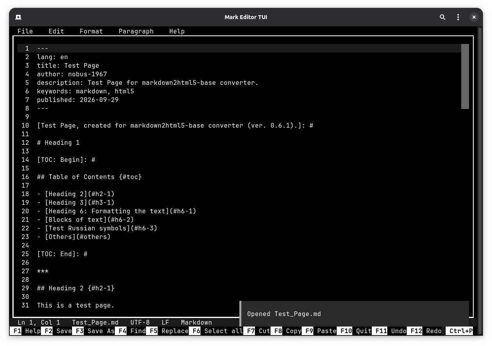

# Mark Editor TUI



A terminal Markdown editor written in Python with [Textual](https://textual.textualize.io/). It runs in a reasonably modern terminal on Linux.

Mark Editor TUI is based on [Mark Editor](https://github.com/nobus-1967/mark_editor). HTML and plain-text conversion is provided by [markdown2html5-base](https://github.com/nobus-1967/markdown2html5-base), and PDF export uses [markdown2pdf-base](https://github.com/nobus-1967/markdown2pdf-base).

**Actual version is 0.2.1 (2026.11).**

## Features

- Edit standard Markdown and GFM extensions with syntax highlighting and line numbers.
- File actions: New, Open, Reopen, Save, Save As.
- Exports: HTML5, HTML5 with embedded CSS3, PDF (portrait or landscape) and plain text.
- Find, replace and replace-all, optionally with regular expressions.
- Formatting: bold, italic, underline, strikethrough, superscript, subscript, inline code, highlighted text, links, footnotes, comments and escapes.
- Paragraph commands: headings 1–6, paragraphs, ordered/unordered/todo lists, definition lists, blockquotes, fenced code blocks, images, horizontal rules,
  hard line breaks and YAML Front Matter.
- Tables: create tables with headers, body rows and a footer; add rows; set cell alignment; balance column widths.
- Table of contents: add, regenerate, remove, or add heading IDs only.
- Language markers, BCP 47 language-code picker, furigana/ruby annotations, emoji shortcodes and special signs.
- Four color themes (`default`, `green`, `magenta`, `blue`) with `File → Toggle Theme` (`Alt+T`), persisted between runs.
- Command palette (`Ctrl+P`) and clickable menus: File, Edit, Format, Paragraph, Help.
- Built-in help: the complete keyboard-shortcut reference and About.

Browser preview is intentionally **not** part of the TUI. Use the HTML5 or PDF export when a rendered document is needed.

## Requirements

- Linux.
- Python 3.10 or newer.
- [Textual](https://pypi.org/project/textual/) 8 or newer.
- [markdown2html5-base](https://github.com/nobus-1967/markdown2html5-base) for
  HTML/text conversion.
- [markdown2pdf-base](https://github.com/nobus-1967/markdown2pdf-base) plus
  `pandoc` and XeLaTeX for PDF export.

## Installation

```bash
cd application
python3 -m venv ../venv
../venv/bin/python -m pip install -e .
```

`pip install -e .` installs the `mark_editor_tui` command and the dependencies declared in `pyproject.toml`.

For the development tools as well:

```bash
../venv/bin/python -m pip install -e ".[dev]"
```

## Running

```bash
../venv/bin/mark_editor_tui [FILE]
```

Alternatively, from a checkout without installing the package:

```bash
cd application
PYTHONPATH=src ../venv/bin/python -m mark_editor_tui [FILE]
```

The optional `FILE` argument opens a Markdown document at startup.

Command-line options:

| Option            | Description                                                 |
| :---              | :---                                                        |
| `-h`, `--help`    | Show a brief description of the program and its options.    |
| `-v`, `--version` | Print the application name, version and release, then exit. |

## Function-key layout

The F1–F12 row follows the classic console-editor layout and is the primary shortcut set. Ctrl and Alt combinations remain available as aliases. The row ends with a clickable `Ctrl+P Command palette` hint; the whole bar needs a terminal at least 135 columns wide.

| Key   | Action     | Key   | Action |
| :---: | :---       | :---: | :---   |
| `F1`  | Help       | `F7`  | Cut    |
| `F2`  | Save       | `F8`  | Copy   |
| `F3`  | Save As    | `F9`  | Paste  |
| `F4`  | Find       | `F10` | Quit   |
| `F5`  | Replace    | `F11` | Undo   |
| `F6`  | Select All | `F12` | Redo   |

## Terminal-safe shortcuts

Desktop editors use several key combinations that a terminal cannot deliver or that a shell reserves for itself. Mark Editor TUI moves those actions to function keys or Alt combinations:

| Action            | Primary shortcut      | Why it changed                                                  |
| :---              | :---                  | :---                                                            |
| Undo              | `F11`                 | `Ctrl+Z` sends `SIGTSTP` in many shells.                        |
| Redo              | `F12`                 | Keeps Undo and Redo on the function-key row.                    |
| Quit              | `F10`                 | `Ctrl+Q` is flow control; `Ctrl+Shift+Q` closes a window.       |
| Save              | `F2`                  | Some terminals intercept `Ctrl+S`.                              |
| Copy              | `F8`                  | `Ctrl+Shift+C` belongs to the terminal emulator.                |
| Paste             | `F9`                  | Terminal paste is normally `Ctrl+Shift+V` or `Shift+Insert`.    |
| Select all        | `F6`                  | `Ctrl+A` moves to the beginning of the line in terminals.       |
| Find              | `F4`                  | `Ctrl+Shift+F` is terminal search.                              |
| Replace           | `F5`                  | `Ctrl+Shift+H` may be terminal replace.                         |
| Cut               | `F7`                  | `Ctrl+Shift+X` may be terminal cut.                             |
| Delete line       | `Alt+D`               | No terminal-reserved function key remains free.                 |
| Language wrapping | `Alt+Shift+W`         | `Ctrl+Shift+W` closes a terminal tab.                           |
| Unordered list    | `Ctrl+Shift+G`        | Does not conflict with common terminal shortcuts.               |
| Code block        | `Alt+Shift+K`         | `Ctrl+Shift+K` clears the terminal scrollback.                  |
| Table alignment   | `Alt+Shift+T`         | `Ctrl+Shift+T` opens a terminal tab.                            |
| Balance table     | `Alt+Shift+N`         | `Ctrl+Shift+N` opens a terminal window.                         |
| Clear formatting  | `Alt+Shift+F`         | `Ctrl+Shift+F` is terminal search.                              |
| Italic            | `Alt+I`               | `Ctrl+I` is the same byte as Tab.                               |
| Comment           | `Alt+M`               | `Ctrl+M` is the same byte as Enter.                             |
| Line break        | `Alt+Enter`           | `Ctrl+\` sends `SIGQUIT`.                                       |
| Headings 1–6      | `Alt+1` … `Alt+6`     | GNOME Terminal sends `ESC`+digit; the app restores `Alt`+digit. |
| Paragraph         | `Alt+0`               | —                                                               |
| Blockquote        | `Alt+Q`               | `Ctrl+Shift+Q` closes a window in some terminals.               |
| Todo list         | `Alt+C`               | `Ctrl+Shift+C` is terminal copy.                                |
| Header ID         | `Alt+H`               | `Ctrl+H` is Backspace.                                          |
| Line up/down      | `Alt+Up` / `Alt+Down` | `Ctrl+Up/Down` usually scrolls the terminal.                    |

Other `Ctrl+Shift` combinations (for example `Ctrl+Shift+P`, `Ctrl+Shift+B`, `Ctrl+Shift+M`) are kept because common terminals do not reserve them. Press `F1` or open **Help → Keyboard Shortcuts** for the complete shortcut list.

## Keyboard overview

### File

| Action         | Shortcut                              |
| :---           | :---                                  |
| New file       | `Ctrl+N`                              |
| Open           | `Ctrl+O`                              |
| Reopen         | `Ctrl+Shift+O`                        |
| Save / Save As | `F2`, `Ctrl+S` / `F3`, `Ctrl+Shift+S` |
| Export         | `Ctrl+E`                              |
| Quit           | `F10`                                 |

### Edit

| Action                 | Shortcut                                                     |
| :---                   | :---                                                         |
| Undo / Redo            | `F11` / `F12`                                                |
| Cut / Copy / Paste     | `F7`, `Shift+Delete` / `F8`, `Ctrl+C` / `F9`, `Shift+Insert` |
| Select all / deselect  | `F6`, `Ctrl+A` / `Ctrl+Shift+A`                              |
| Find / Replace         | `F4`, `Ctrl+F` / `F5`, `Ctrl+R`                              |
| Go to line             | `Ctrl+_`                                                     |
| Delete line            | `Alt+D`                                                      |
| Indent / outdent       | `Tab` / `Shift+Tab`                                          |
| Move line or selection | `Alt+Up` / `Alt+Down`                                        |

### Formatting

| Action                     | Shortcut                        |
| :---                       | :---                            |
| Bold                       | `Ctrl+B`                        |
| Italic                     | `Alt+I`                         |
| Underline                  | `Ctrl+U`                        |
| Strikethrough              | `Ctrl+D`                        |
| Superscript / subscript    | `Ctrl+Shift+P` / `Ctrl+Shift+B` |
| Inline code                | `Ctrl+K`                        |
| Mark / highlight           | `Ctrl+Shift+M`                  |
| Hyperlink                  | `Ctrl+L`                        |
| Header ID / header link    | `Alt+H` / `Ctrl+Shift+H`        |
| Footnote                   | `Ctrl+Shift+U`                  |
| Table of contents          | `Ctrl+Shift+E`                  |
| Language marker / wrapping | `Ctrl+W` / `Alt+Shift+W`        |
| Language codes             | `Alt+L`                         |
| Furigana                   | `Ctrl+Shift+J`                  |
| Date and time              | `Ctrl+Shift+D`                  |
| Comment                    | `Alt+M`                         |
| Special mark (backslash)   | `Ctrl+Shift+L`                  |
| Clear formatting           | `Alt+Shift+F`                   |
| Emoji / special signs      | `Alt+E` / `Alt+S`               |

### Paragraphs and blocks

| Action                   | Shortcut                  |
| :---                     | :---                      |
| Heading 1–6              | `Alt+1` … `Alt+6`         |
| Paragraph                | `Alt+0`                   |
| Ordered / unordered list | `Ctrl+G` / `Ctrl+Shift+G` |
| Todo list                | `Alt+C`                   |
| Definition list          | `Ctrl+Shift+X`            |
| Code block               | `Alt+Shift+K`             |
| Blockquote               | `Alt+Q`                   |
| Table                    | `Ctrl+T`                  |
| Add table row            | `Ctrl+Shift+R`            |
| Table alignment          | `Alt+Shift+T`             |
| Balance table            | `Alt+Shift+N`             |
| Image                    | `Alt+G`                   |
| Horizontal rule          | `Alt+-`                   |
| Line break               | `Alt+Enter`               |
| YAML Front Matter        | `Ctrl+Shift+Y`            |

### Help and appearance

| Action              | Shortcut           |
| :---                | :---               |
| Command palette     | `Ctrl+P`           |
| Toggle color theme  | `Alt+T`            |
| Help                | `F1`               |
| Menus               | Click a menu title |

**File → Toggle Theme** (just before **Quit**) or `Alt+T` cycles through four themes:

| Theme   | Appearance                                                                                |
| :---    | :---                                                                                      |
| default | Black background, white text; active menu items and selections are white with black text. |
| green   | Like default, but white text and highlights are bright green.                             |
| magenta | Like default, but white text and highlights are magenta.                                  |
| blue    | Like default, but with a deep-blue background, navy panels and pale-blue text.            |

The selected theme is stored in `~/.config/mark_editor/theme.json` under the `mode` key. Delete that file to return to the default theme. The full palette reference is in [themes.md](./themes.md).

The recommended font is Noto Sans Mono; PDF export uses Noto Sans Mono together with the Noto Sans Mono CJK variants and Symbola for symbols and checkboxes. The terminal emulator controls the actual font family and rendering size; font selection is not available inside the TUI.

## Package structure

```
application/
  pyproject.toml        # Build metadata, dependencies, entry point and tooling
  README.md
  themes.md             # Palette reference for the repository (not packaged)
  LICENSE
  .gitignore
  requirements.txt      # Runtime dependencies (mirrors pyproject.toml)
  assets/
    docs/
      cheatsheet.md     # Keyboard shortcuts (same as Help → Keyboard Shortcuts)
    images/             # Screenshots
  src/
    mark_editor_tui/
      __init__.py       # Package metadata
      __main__.py       # python -m mark_editor_tui
      main.py           # CLI entry point
      app.py            # Textual application, actions and menus
      editor.py         # Markdown TextArea widget
      screens.py        # Modal dialogs and the file chooser
      menubar.py        # Clickable menu bar
      markdown_ops.py   # Pure Markdown text transformations
      helpers.py        # Conversion, TOC and temp-file helpers
      themes.py         # Application and editor color themes
      constants.py      # Version, theme names, formats and language tables
      help_text.py      # Help and About documents
      styles.tcss       # Textual stylesheet
  tests/
    test_editor.py      # Unit and headless UI tests
```

## Temporary files

While editing, the buffer is saved to a tilde file so that a crashed or terminated session can be restored:

- No file open: `~/.cache/mark_editor_tui/Temp.md`.
- File open: `~/<name>.md` next to the document.

Temporary files are deleted when the application exits or when the document is closed. If a non-empty `Temp.md` exists at startup, its contents are restored and the document is marked as modified.

## Development

Run the unit tests with the standard library test runner:

```bash
cd application
../venv/bin/python -m unittest discover -s tests -v
```

Lint and format with Ruff:

```bash
ruff check src tests
ruff format --check src tests
```

Build source and wheel distributions with the standard `build` frontend:

```bash
cd application
../venv/bin/python -m pip install build
../venv/bin/python -m build
```

The wheel contains the `mark_editor_tui` package and the Textual stylesheet. PDF export still relies on the host `pandoc` and XeLaTeX.

## Single-file Linux binary

`build.sh` uses PyInstaller to bundle Python, Textual, and all runtime dependencies into one executable. The result is Linux-only and targets the CPU architecture and glibc version of the build host.

Install PyInstaller into the project virtual environment:

```bash
# from the repository root
venv/bin/python -m pip install pyinstaller
```

Then build the binary:

```bash
cd application
./build.sh
```

The script writes `bin/mark-editor-bin` and prints its size and SHA256 checksum. The executable is self-contained, so Python does not need to be installed on the target system. To install it for the current user:

```bash
install -m 755 bin/mark-editor-bin ~/.local/bin/mark-editor-bin
```

Run it like the regular command:

```bash
~/.local/bin/mark-editor-bin --version
~/.local/bin/mark-editor-bin document.md
```

PDF export still requires `pandoc` and XeLaTeX on the host.

## Keyboard shortcuts

See [the offline shortcut reference](./assets/docs/cheatsheet.md). It matches the in-app **Help → Keyboard Shortcuts** page. The **Help** menu also contains **About Editor**.

## License

See [LICENSE](./LICENSE).
